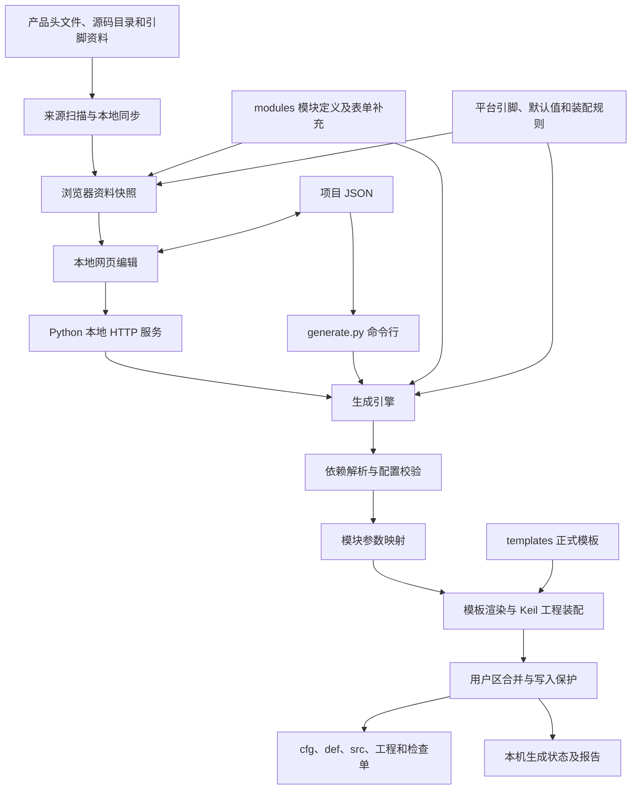

# PBRD 技术框架说明

本文说明当前仓库的实际结构与执行流程，供使用者和维护者阅读。设计约定与扩展步骤另见 [ADDING_MODULES.md](ADDING_MODULES.md)，写入和维护操作见 [GENERATION.md](GENERATION.md)，上传范围见 [REPOSITORY.md](REPOSITORY.md)。

## 1. 工具定位和运行环境

PBRD 是放在产品工程旁的板级配置与代码生成工具。用户在本地网页描述板级功能，保存项目 JSON，生成板级 C 源码、定义头、配置文件和 IDE 工程。

当前正式生成入口限定为 **AC78428 / Keil 5.23**。Python 日常运行使用标准库；页面使用原生 JavaScript、HTML 和 CSS，没有前端框架、Node 构建链、数据库或云服务。Node.js 用于开发验证；部分浏览器验证另需 Playwright。真实编译需要外部 ARMCC 和产品 SDK。

页面中的“保存并构建工程”表示保存配置并生成工程，**不会自动调用 Keil 编译或发布 SDK**。编译验证由独立测试脚本完成。

典型目录关系：

```text
产品工程根目录/
├─ product/src/
│  ├─ brd/base/             产品已有的公共板级接口
│  ├─ brd/mcu/              产品已有的 MCU 适配
│  ├─ brd/r01v01/           生成输出示例，名称不是限制
│  ├─ drv/                  产品已有驱动
│  ├─ per/                  产品已有器件实现
│  └─ hal/                  产品已有 HAL
└─ pbrd/                    独立 Git 仓库
```

PBRD 不随仓库打包产品 SDK、编译器和 IDE，不能仅克隆工具仓库就离开产品工程编译板级代码。默认通过 `pbrd.config.json` 的 `project_root: ".."` 定位产品工程；可通过命令行覆盖项目根目录。

## 2. 总体数据流



资料扫描不等于模板开发。扫描只能发现文件、枚举、驱动和待接入能力，不会自动写出或审核一个新器件的 C 适配。已有板级目录可以用于可选导入和差异比较，不在常规生成过程中充当复制底稿。

## 3. 代码分层与职责

| 层次 | 核心位置 | 职责 |
| --- | --- | --- |
| 启动与项目定位 | `start-config.cmd`、`ui/project_context.py`、`pbrd.config.json` | 定位产品项目、启动服务 |
| 来源管理与扫描 | `ui/source-settings.json`、`ui/source_catalog.py`、`ui/project_scan.py`、`scan-project.py` | 读取枚举、发现源码、输出能力缺口 |
| 模块资料 | `modules/*.json`、`ui/module_library.py` | 模块字段、默认值、器件实现、依赖和支持状态 |
| 前端补充定义 | `ui/frontend-fields.json` | 复杂表单的字段补充及目标约束，与模块定义合并 |
| 前端模型 | `ui/frontend-model.js` | 配置归一化、旧格式迁移、可见性等模型逻辑 |
| 页面交互 | `ui/app.js`、`ui/style.css` | 编辑、联动、依赖提示、IO 总表、导入导出 |
| 数据装载 | `ui/data-loader.js` | 本地同步、资料安装、保存和生成 API 调用 |
| 网页打包 | `ui/build_catalog.py`、`ui/build_preview.py` | 生成快照与单 HTML 页面 |
| 本地服务 | `ui/local_server.py`、`ui/folder_picker.py` | 提供网页、读写 JSON、选择目录、调用生成器 |
| 生成调度 | `generator/engine.py` | 校验、目标拆分、模块生成调度、报告与发布 |
| 依赖解析 | `generator/registry.py` | 展开 BRD、DRV、PER、HAL、IDP 依赖 |
| 模块映射 | `generator/modules/` | 高层字段转为具体 C 配置对象和引用 |
| 通用生成 | `generator/c_format.py`、`generator/template.py` | C 初始化格式、表达式与模板占位符处理 |
| 工程装配 | `generator/projects/keil.py` | Keil 成员和路径组织 |
| 写入与用户区 | `generator/writer.py`、`generator/user_sections.py` | 状态清单、摘要、合并、写入、失败回退 |
| 生成文档 | `generator/documentation.py` | 检查单、配置行注释和能力宏整理 |
| 参考导入 | `ui/project_preset.py`、`generator/c_parser.py` | 从已知源码风格恢复输入，非通用 C 编译前端 |

模块声明和页面补充是两个资料入口，维护新字段时必须检查二者的合并结果。普通字段应通过模块 JSON 增加；引脚联动等特殊行为目前仍有代码实现在 `app.js`，不是所有交互都完全声明化。

## 4. 四类数据及其边界

### 4.1 项目输入：项目 JSON

这是用户需要保存和复用的配置。一个文件可以包含 App 和 Boot。主要结构如下（省略业务实例）：

```json
{
  "format": "pbrd-project",
  "schema_version": 1,
  "ui_schema_version": 2,
  "project": {
    "model": "产品型号",
    "revision": "R01V01",
    "author": "软件工程院",
    "date": "2026-10-21",
    "product_enum": "有效产品枚举"
  },
  "platform": {"mcu": "ac78428", "package": "144LQFP"},
  "build": {"adapter": "keil", "version": "5.23"},
  "targets": {
    "app": {"requested": [], "disabled": [], "touched": []},
    "boot": {"requested": [], "disabled": [], "touched": []}
  },
  "board": {"modules": {}, "buses": []},
  "driver_settings": {},
  "output": {
    "automatic": false,
    "directory": "product/src/brd/r01v01",
    "mode": "create"
  }
}
```

上例只解释形状，不能直接作为可生成项目；产品枚举、基础模块和已使能模块实例还需补全。

- `project`：产品、版本、作者、日期和产品枚举。作者为空时默认软件工程院。版本从 R/V 组成部分解析；目标可单独保存 `software_minor`。
- `targets`：目标功能开关。`requested` 是显式选择，`disabled` 是明确禁用；有效集合通过依赖解析计算，不能把旧的 `resolved` 当成最终权威。
- `board.modules`：以模块 id 为键的实例数组。实例包含 `uid`、功能名称 `name`、枚举 `enum`、适用 `targets` 和 `params`。功能名用于人读，枚举用于 C 接口，uid 用于编辑识别。
- `board.buses`：公共总线资源，包含资源 id、类型、硬件实例、角色引脚、复用信息及目标范围。器件通过资源 id 引用。
- `output`：源码目录、创建/重新生成模式、JSON 保存目录和文件名，可包含可选比较版本。
- `driver_settings`：保留字段；当前非空值没有通用后端适配，会明确拒绝生成。
- `codegen`：兼容已有结构化模板参数，也可包含导入的生命周期顺序；不是全部都由当前高层字段替代。v2 项目未带它时，由正式平台 defaults 提供底层默认参数。
- 导入迁移保留未知已有配置，不能因为新页面暂不认识就默默删除。保留数据不等于生成器支持该能力；不支持时应报错。

### 4.2 模块资料：modules

模块 JSON 描述功能而非某一块板的实例：名称、字段、字段默认值、依赖、器件实现、总线种类、目标限制、源码证据和支持状态。

字段类型包括 text、num、bool、select、gpio、adc、channel、signal、bus、power_ref。补充元数据包括：

- `help`：字段下方说明。
- `hardware_kind`：按芯片资料生成 SPI/IIC 硬件实例选项。
- `pin_signal`：从当前参数解析功能名，例如 `SPI{instance}_SCK`，筛选引脚并显示 ALT。
- 可见性条件和器件实现选择：决定字段及依赖是否适用。

`configuration_mode` 区分实例配置与平台配置；`configuration_status` 区分已接入高层模板、底层参数模板、仅有参考等阶段。内部模块可标为 `selection_mode=internal`，不作为独立用户选项。一个模块被扫描到或显示在页面上，并不表示它已经通过生成与编译验收。

### 4.3 平台资料：platforms

| 文件 | 内容 | 修改时机 |
| --- | --- | --- |
| `<mcu>.json` | 引脚、封装编号、复用信号、ALT 等 | 引脚资料接入或修正 |
| `<mcu>-defaults.json` | 已审核固定配置及底层模板参数 | 公共平台默认值变化 |
| `<mcu>-generation.json` | 文件模板映射、声明与计数、目标成员、扩展模块、生命周期、能力宏等 | 生成布局、依赖或工程装配变化 |

平台文件是正式工具输入，应提交 Git。即使部分内容最初通过源码整理得到，也不能因“来源于扫描”就当缓存忽略。

### 4.4 本机派生数据

`ui/platform-data.js` 是浏览器快照，`board-config-preview.html` 是打包网页，都可在启动时重建。`.reports/` 存扫描报告、差异、测试结果、编译中间文件和生成状态，不是项目业务输入。

其中 `.reports/generation/.../.pbrd-manifest.json` 不是可随意清掉的普通缓存，它记录后续重新生成所需摘要。它不上传工具仓库，但本机应保留；换机器生成已有输出时，应优先生成到新目录对比，不能默认能够接管原目录。

## 5. 启动、同步、保存和生成

### 5.1 启动

Windows 运行 `start-config.cmd`，优先使用 Python launcher，否则使用 python，进入 `ui/local_server.py`。服务启动过程刷新资料快照和网页包，使用本地回环地址提供页面。默认端口可由系统分配，命令行支持指定端口、禁止自动开浏览器和覆盖产品根目录。

离线 HTML 可以预览和编辑内置资料；文件夹选择、本地同步、服务端保存和生成需要本地服务。

### 5.2 本地同步

来源路径由 `ui/source-settings.json` 配置。同步读取当前产品头文件、平台资料和模块库，校验返回的数据形状后安装到页面资料对象。同步失败时页面可保留内置资料并提示错误；这不表示资料已更新成功。

扫描入口 `scan-project.py` 输出能力及缺口报告。扫描不会执行发现的产品源码，也不会自动增加未审核的模板实现。

### 5.3 服务接口

| 接口 | 用途 |
| --- | --- |
| `GET /api/context` | 当前产品及工具路径 |
| `GET /api/source-settings` | 来源设置 |
| `POST /api/source-settings` | 校验并保存来源设置 |
| `POST /api/local-sync` | 更新枚举、平台和模块资料 |
| `GET /api/platforms` | 平台列表 |
| `GET /api/platform/<mcu>` | 指定平台资料 |
| `GET /api/enums` | 当前公共板级枚举 |
| `GET /api/modules` | 模块资料 |
| `GET /api/project-scan` | 项目扫描结果 |
| `GET /api/project-preset` | 已知项目的参考导入 |
| `GET /api/generation-dependencies` | 平台底层依赖资料 |
| `GET /api/generation-defaults` | 历史模板示例兼容参数接口 |
| `POST /api/select-json-directory` | 本机文件夹选择 |
| `POST /api/save-project-json` | 保存项目 JSON |
| `POST /api/generate-project` | 调用生成器 |

这些接口是本机工具接口，不是多用户远程协作服务。保存 JSON 使用同目录临时文件加替换操作；目录和文件名由用户设置。页面“保存并构建”先保存，再请求生成，因此后一步失败时 JSON 可能已经保存成功。

## 6. 页面资源与联动

公共初始化统一管理物理 SPI、物理 IIC 和模拟 IIC。器件只引用资源名称；共享同一物理总线的器件不重复创建驱动和引脚配置。物理总线硬件实例来自芯片复用数据，模拟 IIC 的实例是软件资源编号。

引脚控件支持候选列表选择和手动输入，但手动输入仍需属于当前候选集合，并进行大小写归一化。选硬件实例后，引脚候选按功能筛选；复用编号来自芯片资料。

当前专门联动包括：

- ADC：引脚与 ADC 通道匹配。
- 脉冲计量：从所选引脚的 `PWMn_CHm` 功能得到硬件实例和捕获通道；排除 PWM 故障输入等非捕获功能。
- XCU / Boot XCU SPI：SPI 实例下拉，引脚显示对应信号和 ALT；REQ 按普通 GPIO 配置。
- 公共电引用：限定当前目标可用的公共电源；旧的无效引用明确提示，不把所有受控电源混入候选。
- CAN：普通通道与 CAN FD 分开处理，可配置两路公共供电引用。
- 功能名称与板级枚举分别维护，不用枚举名代替业务名称。

页面提供依赖、IO 总表和配置检查。浏览器检查与后端校验是两套实现：关键生成约束以后端为准，目前并非每个 UI 提示都在后端具有完全相同的实现，也没有通用的原理图电气规则验证。

## 7. 依赖解析和 Boot/App

依赖标识包括 `brd.*`、`drv.*`、`per.*`、`hal.*`、`idp.*`。生成器从目标 requested 集合出发，递归展开：模块固定依赖、器件实现依赖、所引用总线依赖、电源依赖，以及适用的平台底层依赖。

所需依赖被明确禁用时生成失败。手动使能的驱动如果没有 BRD 关联，页面给出警告；这个警告有助于发现从历史工程成员导入的冗余选择，不能通过隐藏警告替代核对实际用途。

一个 JSON 中的 Boot/App 可有不同功能集合，实例和总线通过 targets 限定范围。但当前部分模块使用共享配置或公共物理资源，后端会要求适用实例集合保持一致。不能仅凭 JSON 能写两份参数就认为所有模块都支持目标隔离。

App XCU 与 Boot XCU SPI 是独立适配：

- App `brd.xcu` 使用 HAL XCU 和专用 SPI 驱动，配置线程栈等参数，当前要求单个实例。
- Boot `brd.xcu_spi` 不依赖 App HAL，按 Boot 参数配置 SPI、REQ、DMA 和超时，支持不同硬件实例。
- Boot 回调按硬件编号命名，例如 `Brd_XcuSpi1DoAfterOpen`，不按数组排序编号。
- `Brd_XcuSpiInit/Done` 不自动放进 common 生命周期；其调用由使用方管理。生成器也过滤旧生命周期数据中的这两项调用。

## 8. 生成引擎的执行阶段

1. 深拷贝输入，校验格式、平台、工具链、产品枚举、版本和元数据；计算输出目录。
2. 加载模块库、平台引脚、装配规则；必要时补充正式 defaults 底层参数。
3. 解析各目标依赖，拒绝没有完整适配的选中能力、缺少实例和待审核导入项。
4. 校验枚举、实例数量、总线和共享约束。当前句柄映射容量限制为每模块最多 64 个实例。
5. 为公共总线分配 C 对象槽位；解析资源引用为具体驱动或配置指针。
6. 调用模块适配器，将高层需求映射到 C 初始化结构、回调、宏及枚举。
7. 遍历平台文件声明并渲染正式模板，跳过未使能模块，按所选器件整理头文件和源码。
8. 组装 Keil 工程与脚本，按实际输出位置重算引用路径，更新 BRD 导出清单。
9. 整理有意义的配置注释、能力宏和硬件检查单，生成可选差异报告。
10. 交给写入器合并用户区、核对历史摘要，再发布产物和状态。

`generator/modules/builtins.py`、`devices.py` 和 `additional.py` 是当前实际适配实现分组，不是运行时自动插件系统。`compact.py` 负责部分重复配置宏展开参数，`headers.py` 负责高层模块定义头。公共 C 初始化格式位于 `c_format.py`。

计数来自实际数组长度；空配置按接口要求输出 0/NULL。对象名称尽量包含芯片或实际硬件含义；地址采用器件宏或命名宏。代码布局与注释既涉及模板，也涉及参数映射和最终注释整理，因此风格修复不一定只改模板一个文件。

例如没有任何 CAN FD 通道时不输出 FD 专用定义和实现引用；外部 RTC 不额外生成板级对象定义头，默认也不创建自定义定时器对象。

## 9. 输出、重新生成和故障处理

常见输出包括 App/Boot 的 cfg、def、src、Keil 工程、构建脚本和 `check_list.md`。工程引用产品已有的 BRD/DRV/PER/HAL 实现；它们不是都被复制进输出目录。

自动目录通常为 `product/src/brd/<版本>`；手动目录允许相对产品根目录或绝对路径，不限制 r01v01 等名称。可选比较版本只影响差异报告；若设置 compare_to，该参考目录必须存在且符合比较版本格式，否则生成失败。清空比较选项后不应依赖旧版本目录供给生成数据。

写入模式：

- create：输出目录已存在则停止。
- regenerate：明确重新生成，依据状态清单识别已管理文件。
- 模板约定的 user includes/defines/code 区可保留；生成区被手动改动时拒绝更新。
- 移除模块时，如果对应文件含用户代码或生成区手改，则停止删除并要求维护者处理。
- 输出文件路径必须留在选定输出目录内部。

写入器采用独占锁、临时 staging 目录、逐文件替换和异常回退，并同步本机生成状态。它不是数据库级或断电级原子事务，进程被强杀、磁盘故障、文件占用仍需根据错误和状态恢复。不要直接删除锁或状态来强制覆盖尚不明确的文件。

`.reports/generation/<输出目录名>/` 存状态和报告；自定义位置的状态目录追加路径摘要，避免同名目录冲突。报告包含有效配置、配置摘要、来源、数量、差异和生成结果。生成报告中的 compile_status 不代表独立编译脚本已经执行。

## 10. 扩展和维护方法

### 新器件或模块

先审核真实接口与工程成员，再补模块定义、字段/帮助、依赖、总线能力、参数映射、模板、平台装配和验证。只加一个页面选项不能算完成。只有扫描证据、还缺实现的能力应保留明确的待接入状态。

项目引脚、实例和供电关系修改进入项目 JSON；影响所有产品的命名、注释、默认结构进入工具源码。不要把某个产品的临时参数写成公共模板事实。

### 新 MCU

需要引脚和封装资料、正式默认参数、generation 装配规则、MCU 模板、驱动及板级映射，并调整当前入口对平台的限制。只增加平台下拉项不足以支持新 MCU。

### 新工具链

需要工程适配器、版本与校验支持、成员/包含路径/宏映射、构建脚本和真实工具链验证。当前 IAR、CMake 不能仅凭资料结构或预留选项视为已支持。

### 已有工程导入

参考导入使用已知 C 风格解析，不是完整 C 预处理器或编译器。应人工核对宏、条件编译、首项枚举、源码成员、未用驱动及回调。导入恢复的是输入，生成仍走正式适配与模板。

## 11. 验证层次和当前边界

| 层次 | 方法 | 能证明什么 |
| --- | --- | --- |
| 资料与启动 | 扫描、JSON 加载、local_server --check | 来源可读及基本结构可用 |
| 页面模型 | Node VM、迁移和控件验证 | 数据转换与生成控件逻辑 |
| 真浏览器 | Playwright 用例 | 实际页面交互流程 |
| 生成语义 | 参数断言、C 声明解析、预处理比较 | 配置对象及宏展开符合预期 |
| 工程编译 | ARMCC 编译生成单元 | 已测配置的语法、类型及引用可用 |
| 硬件验证 | 人工检查单和实机测试 | 电气、时序、器件及运行行为 |

已有测试包含可复用用例和当前产品专项用例。后者可能依赖忽略的 configs、原 r01v02、审阅输出或本机 ARMCC 路径，克隆后不能直接当作通用 CI。详见 tests/README.md。

当前没有通用硬件电气冲突引擎、完整 C 语言反向工程、任意 MCU/工具链自动适配或自动硬件验收。部分运行时波特率、量程、采样率等应由上层调用设置，不能推断页面未提供的运行参数已自动生效。当前框架采用模板与明确适配的方式逐项接入能力。
